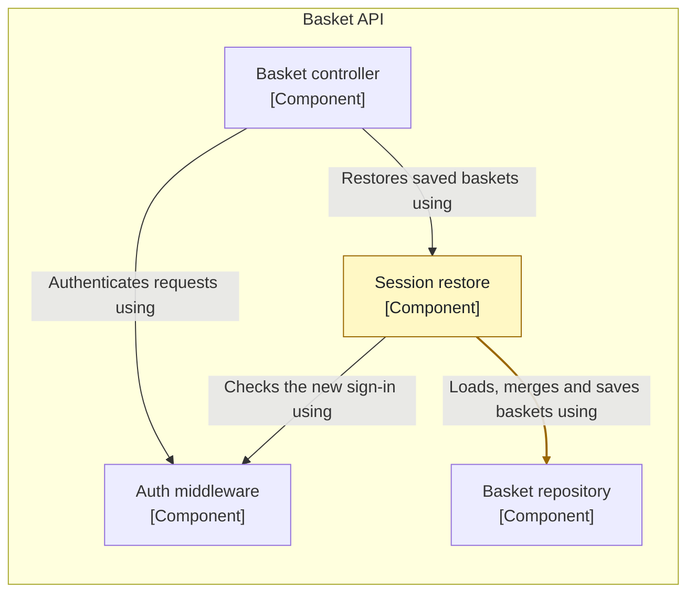
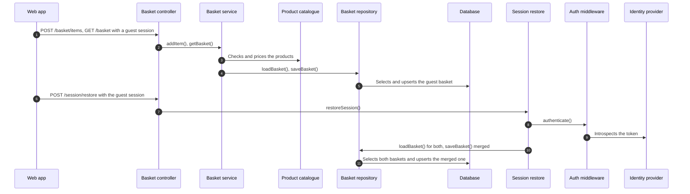

### ⚠️ Target change

This PR changes the target, so merging it approves the change. Read this before the code.

Changed: `architecture/workspace.dsl`

- Changes Session restore (description).
- Changed relationship: Session restore → Basket repository ("Loads, merges and saves baskets using").
- New dynamic view: #20.

#### Components: what changes in Basket API

Only what changes at each level and its neighbours. 🟩 added · ⬜ removed, dashed · 🟨 changed

#### Dynamic views

#20 Fill a basket as a guest

#### Model diff

| | Added | Removed | Drifted |
| --- | --- | --- | --- |
| Elements |  |  | `sessionRestore` (description) |
| Relationships |  |  | `sessionRestore->basketRepository` (description) |
| Dynamic views | `req-20` |  |  |

21 elements and relationships now also serve #20.

No ADR in this PR gives the reason for the change or the alternatives considered.