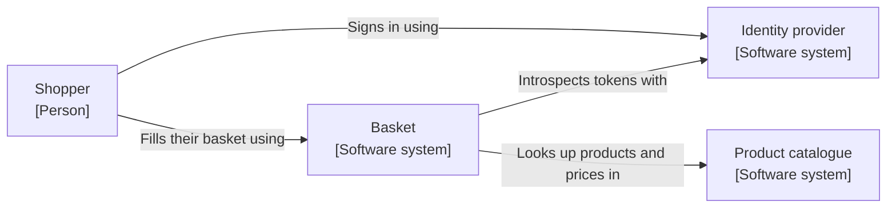
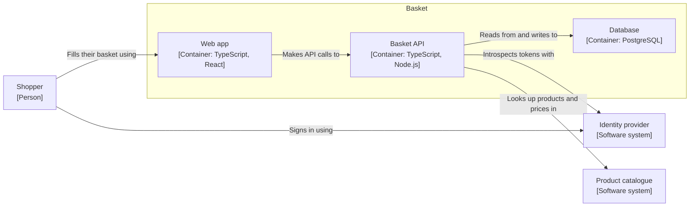
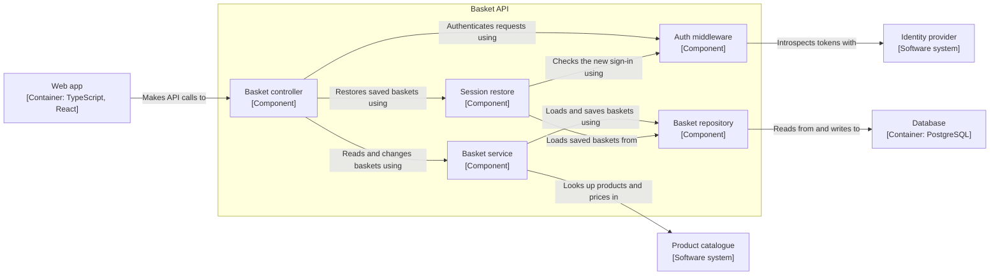
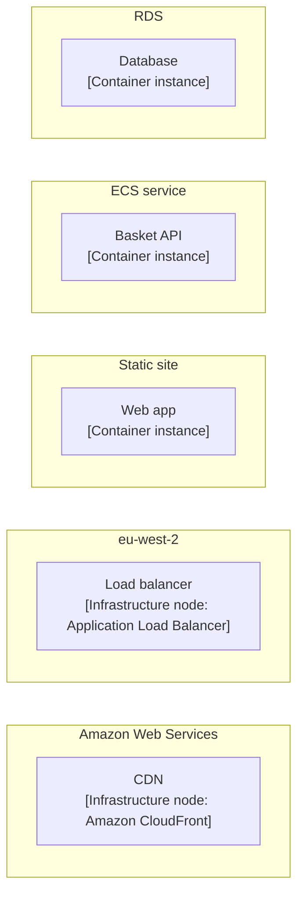
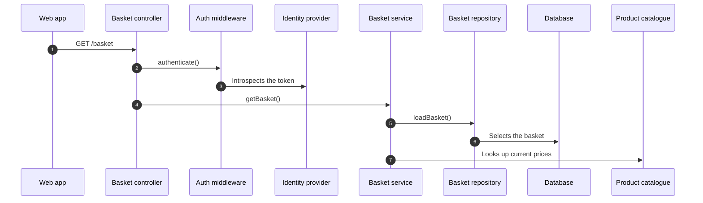
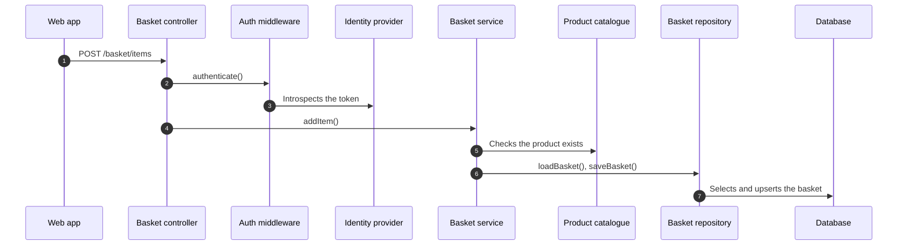
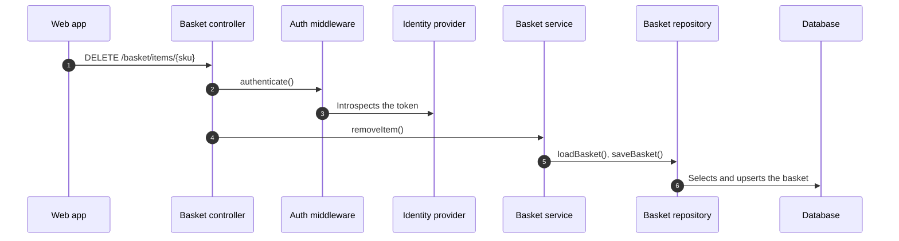
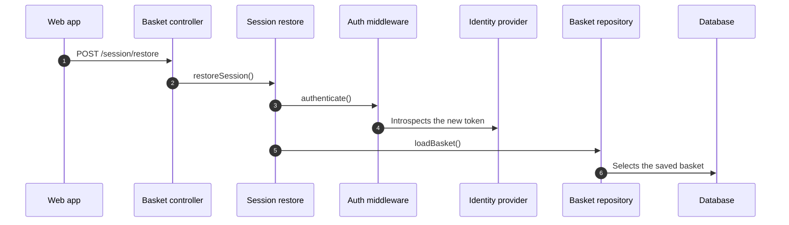
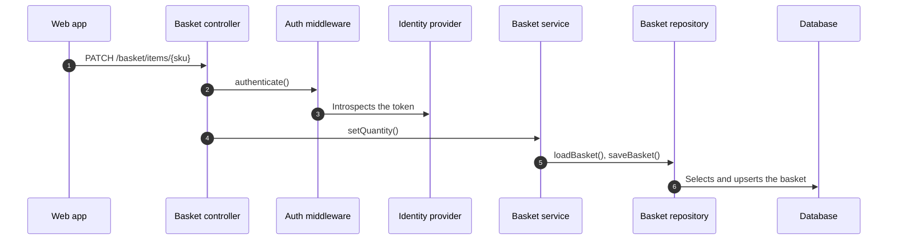
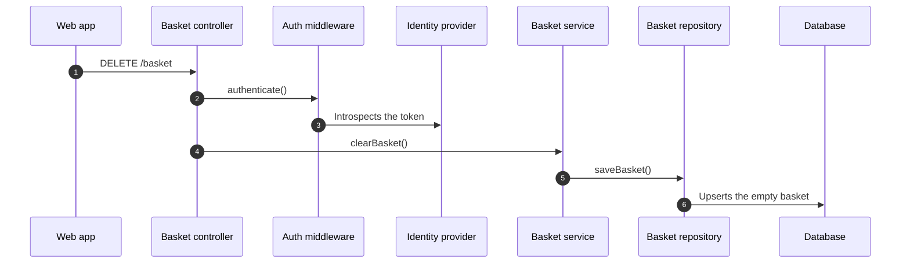

### ⚠️ Target change

This PR changes the target, so merging it approves the change. Read this before the code.

Changed: `architecture/workspace.dsl`

This is the initial target. It defines 1 person, 3 software systems, 3 containers, 5 components and 6 dynamic views.

#### System context

#### Containers

#### Components of Basket API

#### Deployment: Production

#### Dynamic views

#1 View the basket

#2 Add an item to the basket

#3 Remove an item from the basket

#4 Restore the basket after the session expires

#6 Change an item's quantity

#7 Empty the basket

Model diff

| | Added | Removed | Drifted |
| --- | --- | --- | --- |
| Elements | `authMiddleware`, `basket`, `basketApi`, `basketController`, `basketRepository`, `basketService`, `database`, `identityProvider`, `productCatalogue`, `sessionRestore`, `shopper`, `webApp` |  |  |
| Relationships | `authMiddleware->identityProvider`, `basketController->authMiddleware`, `basketController->basketService`, `basketController->sessionRestore`, `basketRepository->database`, `basketService->basketRepository`, `basketService->productCatalogue`, `cdn->site`, `lb->ecs`, `sessionRestore->authMiddleware`, `sessionRestore->basketRepository`, `shopper->identityProvider`, `shopper->webApp`, `webApp->basketController` |  |  |
| Dynamic views | `req-1`, `req-2`, `req-3`, `req-4`, `req-6`, `req-7` |  |  |
| Deployment | `aws`, `cdn`, `ecs`, `ecs/basketApi`, `lb`, `rds`, `rds/database`, `region`, `site`, `site/webApp` |  |  |

No ADR in this PR gives the reason for the change or the alternatives considered.