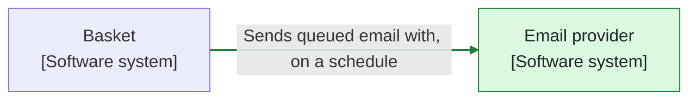
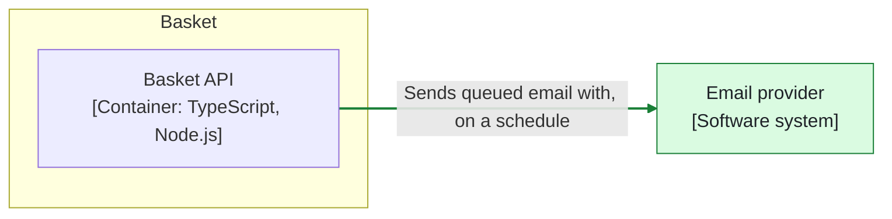
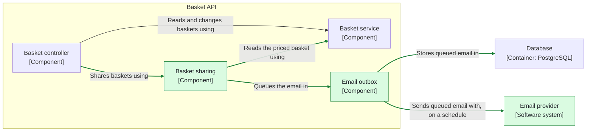
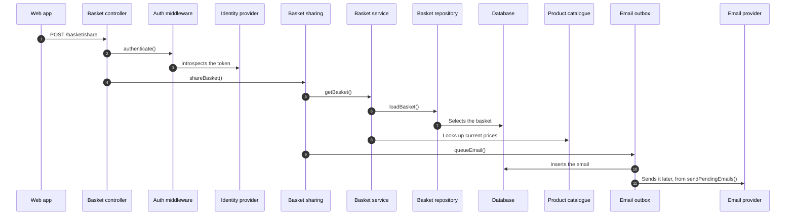

### ⚠️ Target change

This PR changes the target, so merging it approves the change. Read this before the code.

Changed: `architecture/workspace.dsl`

- Adds the Basket sharing and Email outbox components to Basket API, and the external Email provider.
- New relationships: Basket controller → Basket sharing ("Shares baskets using"), Basket sharing → Basket service ("Reads the priced basket using"), Basket sharing → Email outbox ("Queues the email in"), Email outbox → Database ("Stores queued email in") and Email outbox → Email provider ("Sends queued email with, on a schedule").
- New dynamic view: #5.

#### System context: what changes

#### Containers: what changes

#### Components: what changes in Basket API

Only what changes at each level and its neighbours. 🟩 added · ⬜ removed, dashed · 🟨 changed

#### Dynamic views

#5 Share the basket by email

#### Model diff

| | Added | Removed | Drifted |
| --- | --- | --- | --- |
| Elements | `basketSharing`, `emailOutbox`, `emailProvider` |  |  |
| Relationships | `basketController->basketSharing`, `basketSharing->basketService`, `basketSharing->emailOutbox`, `emailOutbox->database`, `emailOutbox->emailProvider` |  |  |
| Dynamic views | `req-5` |  |  |

19 elements and relationships now also serve #5.

No ADR in this PR gives the reason for the change or the alternatives considered.